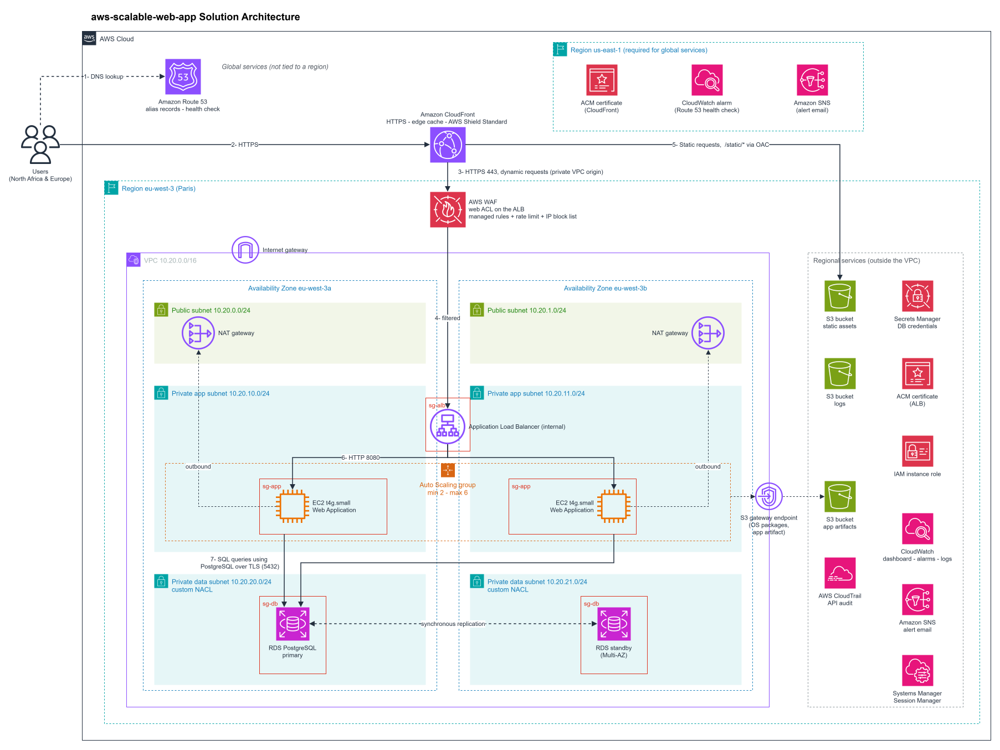

# Scalable Web Application on AWS

**Highly available, secure and auto-scaling web application architecture: Amazon CloudFront, an internal Application Load Balancer with AWS WAF, an Auto Scaling group of EC2 instances across two Availability Zones, and Amazon RDS for PostgreSQL Multi-AZ.**

## Table of contents

- [Solution overview](#solution-overview)
- [Architecture diagram](#architecture-diagram)
- [Request flow](#request-flow)
- [Services and their roles](#services-and-their-roles)
- [Network design](#network-design)
- [Security](#security)
- [High availability and scaling](#high-availability-and-scaling)
- [Failure scenarios](#failure-scenarios)
- [Monitoring and alerting](#monitoring-and-alerting)
- [Design decisions and trade-offs](#design-decisions-and-trade-offs)
- [Well-Architected alignment](#well-architected-alignment)
- [Cost estimate](#cost-estimate)
- [Deployment approach](#deployment-approach)
- [Limitations](#limitations)
- [Author and license](#author-and-license)

---

## Solution overview

The solution hosts a production-grade web application for users concentrated in **North Africa and Europe**. It is designed to:

- **stay available** when an instance, a whole Availability Zone or the database primary fails;
- **scale automatically** with traffic, from 2 to 6 instances;
- **expose nothing but the CDN** to the internet: the load balancer, the servers and the database have no public address.

The architecture does not depend on what the application does. It assumes only what most web applications already are:

- **stateless application servers**: no user session or file is kept on an instance, so any instance can serve any request and instances can be added or replaced at any time;
- **a relational database** for all persistent data;
- **static files** (CSS, JavaScript, images) separable from dynamic pages, so they can be served from S3 and cached at the edge;
- **two health endpoints**: `/health`, which answers if the process is running, and `/health/deep`, which also checks the database connection (see [High availability and scaling](#high-availability-and-scaling)).

Users reach the application only through **Amazon CloudFront**. Static files (CSS, JavaScript, images) are served from a private **Amazon S3** bucket at the edge; dynamic requests travel over a private connection to an **internal Application Load Balancer**, where **AWS WAF** filters them, then to **Amazon EC2** instances in private subnets across two Availability Zones. The instances store their data in **Amazon RDS for PostgreSQL**, with a synchronous standby in the second zone.

| Characteristic | Value |
| --- | --- |
| Region | eu-west-3 (Paris), closest to the users; us-east-1 only for three small pieces AWS requires there |
| Availability | Every tier spans two Availability Zones |
| Recovery targets | Design targets of about **2 minutes to recover (RTO)** and **no loss of committed data (RPO = 0)** after losing an instance, an AZ or the database primary; derived from how the services behave, not an AWS guarantee (see [High availability and scaling](#high-availability-and-scaling)) |
| Scaling | 2 to 6 Graviton `t4g.small` instances; target tracking on CPU plus step scaling on request spikes |
| Public entry point | CloudFront only; the ALB is internal, reached through a CloudFront VPC origin |
| Data | RDS for PostgreSQL 16, Multi-AZ, encrypted at rest, TLS required on every connection |
| Cost | About **USD 183 per month** in production, before any savings plan (see [Cost estimate](#cost-estimate)) |

---

## Architecture diagram

The numbered arrows (1 to 7) are explained step by step in [Request flow](#request-flow).

---

## Request flow

### Dynamic request (a page, a form submission)

1. **DNS lookup (1).** The browser resolves the site name. Route 53 answers from an alias record that points to the CloudFront distribution, for both IPv4 and IPv6.
2. **Edge (2).** The browser connects to the nearest CloudFront edge location over HTTPS; plain HTTP is redirected to HTTPS. AWS Shield Standard, built into CloudFront, absorbs network-level DDoS attacks.
3. **Private origin (3).** Anything outside `/static/*` follows the default cache behaviour: never cached, forwarded to the load balancer. CloudFront reaches the **internal** ALB through a **VPC origin**, a private connection into the VPC, over HTTPS on port 443. It forwards the viewer's `Host` header. On the way, a **CloudFront Function** writes the visitor's real address into an `X-Viewer-IP` header, overwriting any value the visitor sent (see [AWS WAF rules](#aws-waf-rules) for why).
4. **Filtering (4).** The AWS WAF web ACL attached to the ALB evaluates the request before it is routed. A blocked request gets a 403 and never reaches an instance.
5. **Routing.** The ALB's HTTPS listener terminates TLS and applies one rule: if the `Host` header is the site's domain, forward to the application target group; anything else gets a fixed 404.
6. **Application (6).** The ALB picks a healthy instance in either AZ and forwards the request over HTTP on port 8080.
7. **Data (7).** The instance queries the RDS primary over the PostgreSQL protocol, encrypted with TLS. The response travels back the same way.

### Static request (`/static/*`) (5)

CloudFront serves the file from its edge cache. On a cache miss it fetches the file from the private static-assets bucket in S3; each request is signed through **Origin Access Control**, and the bucket policy accepts reads from this distribution only. Instances never see static traffic.

### Encryption on every hop

| Hop | Protocol | Certificate |
| --- | --- | --- |
| Browser → CloudFront | HTTPS | ACM certificate for the site name, in us-east-1 |
| CloudFront → ALB | HTTPS over the private VPC origin connection | ACM certificate in Paris, covering the site and origin names |
| CloudFront → S3 | HTTPS, signed by Origin Access Control | AWS-managed |
| ALB → instances | HTTP on port 8080, inside the private subnets | None: a deliberate trade-off, see [Security](#security) |
| Instances → RDS | PostgreSQL over TLS, enforced by the database (`rds.force_ssl`) | Issued by the RDS certificate authority; the application connects with `sslmode=verify-full` and the RDS CA bundle, so it also verifies it is talking to the real database |

---

## Services and their roles

| Service | Role in this design |
| --- | --- |
| **Amazon Route 53** | DNS for the site; alias records to CloudFront (site) and to the internal ALB (origin); outside-in health check |
| **Amazon CloudFront** | Only public entry point; edge caching; HTTPS for viewers; private path to the ALB; security response headers; a CloudFront Function that records the visitor's real address |
| **AWS Shield Standard** | Automatic protection against network-level DDoS on CloudFront, at no cost |
| **AWS WAF** | Web ACL on the ALB: managed rules, rate limiting, IP blocklist |
| **AWS Certificate Manager** | Free, auto-renewing TLS certificates for CloudFront and the ALB |
| **Application Load Balancer** | Internal layer 7 load balancer across both AZs; health checks; host-based listener rule |
| **Amazon EC2** (Launch Template) | Graviton `t4g.small` instances running the application; the template fixes the image, size, IAM role, encrypted disk and IMDSv2 |
| **EC2 Auto Scaling** | Keeps 2 to 6 instances across both AZs, replaces unhealthy ones, adds capacity under load |
| **Amazon RDS for PostgreSQL** (Multi-AZ) | Managed database with a synchronous standby, automatic failover, daily backups |
| **AWS Secrets Manager** | Holds the database password, generated and stored by RDS; instances fetch it at runtime |
| **Amazon VPC** | Isolated network: subnets, route tables, security groups, network ACL, Internet Gateway |
| **NAT Gateway** | Outbound internet access for private instances (updates, AWS APIs), one per AZ |
| **VPC gateway endpoint for S3** | Private, free path from the instances to S3 |
| **Amazon S3** | Three private buckets: static assets, application builds, logs |
| **AWS IAM** | Instance role with temporary, least-privilege credentials |
| **AWS Systems Manager** (Session Manager) | Logged shell access to private instances without SSH |
| **Amazon CloudWatch** | Metrics, dashboard, alarms, log storage |
| **Amazon SNS** | Emails every alarm to the operator |
| **AWS CloudTrail** | Records every API call in the account |

Everything runs in **eu-west-3 (Paris)** except three resources that AWS requires in **us-east-1**:

- the **CloudFront certificate**: CloudFront only uses certificates stored in ACM in us-east-1;
- the **alarm on the Route 53 health check**: Route 53 publishes health-check metrics only in us-east-1, and an alarm must live in its metric's Region;
- an **SNS topic** for that alarm: an alarm can only notify a topic in its own Region.

---

## Network design

### Address plan

One VPC, **10.20.0.0/16**, split into three tiers across two Availability Zones. Each /24 subnet provides 251 usable addresses (AWS reserves 5 per subnet).

| Subnet | AZ | CIDR | Holds | Outbound route |
| --- | --- | --- | --- | --- |
| Public A | eu-west-3a | 10.20.0.0/24 | NAT Gateway | Internet Gateway |
| Public B | eu-west-3b | 10.20.1.0/24 | NAT Gateway | Internet Gateway |
| Private app A | eu-west-3a | 10.20.10.0/24 | Internal ALB, instances | NAT Gateway A, S3 endpoint |
| Private app B | eu-west-3b | 10.20.11.0/24 | Internal ALB, instances | NAT Gateway B, S3 endpoint |
| Private data A | eu-west-3a | 10.20.20.0/24 | RDS primary* | None (VPC-local only) |
| Private data B | eu-west-3b | 10.20.21.0/24 | RDS standby* | None (VPC-local only) |

\* The roles swap after a failover; the application always connects through the database's DNS name.

### Routing

- **Public subnets** send `0.0.0.0/0` to the **Internet Gateway**. They hold nothing that serves traffic, only the NAT Gateways.
- **Each private app subnet** sends `0.0.0.0/0` to the **NAT Gateway in its own AZ**, so losing one AZ never cuts the other off. Both app route tables also carry the **S3 gateway endpoint** route, keeping S3 traffic (operating system packages, application builds) private and off the NAT bill.
- **Data subnets** have only the local VPC route: the database has no path to or from the internet.
- The **Internet Gateway** is used only by the NAT Gateways. It is also required by CloudFront VPC origins, although they never route traffic through it.

### Network ACL on the data subnets

Security groups do the precise filtering (see [Security](#security)). The data subnets add a stateless second layer around the database:

| Rule | Direction | Protocol and port | Source / destination | Action |
| --- | --- | --- | --- | --- |
| 100 | Inbound | TCP 5432 | 10.20.10.0/24 (app A) | Allow |
| 110 | Inbound | TCP 5432 | 10.20.11.0/24 (app B) | Allow |
| 100 | Outbound | TCP 1024–65535 (replies) | 10.20.10.0/24 (app A) | Allow |
| 110 | Outbound | TCP 1024–65535 (replies) | 10.20.11.0/24 (app B) | Allow |
| * | Both | All | All | Deny |

The public and app subnets keep the default network ACL. Their many legitimate flows (CloudFront, health checks, NAT, S3, Session Manager, return traffic) would each need a stateless rule in both directions, so a custom ACL there would add risk of breaking traffic for little gain over the security groups. CloudFront VPC-origin traffic into the ALB is not evaluated by inbound network ACL rules anyway.

### Why this layout

- **Two Availability Zones.** The minimum for high availability, and what RDS Multi-AZ uses. A third zone would lose a third of capacity instead of half in an outage, but costs another NAT Gateway; the Auto Scaling group already relaunches lost capacity in the surviving zone.
- **One NAT Gateway per AZ.** A single shared NAT Gateway is cheaper, but an outage in its AZ would cut outbound access for both zones. Reliability ranks above cost in this design (see [Well-Architected alignment](#well-architected-alignment)).
- **Internal ALB in the app subnets.** With CloudFront VPC origins, the load balancer needs no public address at all, so nothing that serves traffic is reachable from the internet.

---

## Security

Security is applied at every layer, from the edge inwards, so that no single misconfiguration exposes the application or its data.

### Layers

1. **Edge.** CloudFront is the only component with a public address. It accepts HTTPS only and AWS Shield Standard absorbs network-level DDoS attacks. The AWS managed `SecurityHeadersPolicy` response headers policy, on both cache behaviours, adds browser protections to every response: HSTS (after one visit, browsers never try plain HTTP again), `X-Frame-Options` against clickjacking, `X-Content-Type-Options` against content-type guessing, and a strict `Referrer-Policy`.
2. **Private origin.** The ALB is internal: it has no public address and is reachable only through the CloudFront VPC origin. Its security group also admits HTTPS only from CloudFront's origin-facing address list.
3. **Web filtering.** AWS WAF inspects every dynamic request at the ALB (rules below).
4. **Routing.** The ALB forwards only requests addressed to the site's domain, drops malformed headers, and answers anything else with a 404.
5. **Network isolation.** Instances and database sit in private subnets; the data subnets have no internet route and a custom network ACL (see [Network design](#network-design)).
6. **Security groups**, restricted in both directions (table below).
7. **Identity and secrets.** No passwords or access keys exist on the instances (details below).
8. **Data protection.** Encryption in transit on every hop outside the private subnets (see [Encryption on every hop](#encryption-on-every-hop)) and at rest everywhere.
9. **Access and audit.** No SSH; every shell session and every API call is logged (see [Monitoring and alerting](#monitoring-and-alerting)).

### AWS WAF rules

The web ACL is attached to the ALB and allows by default. Every request reaches the ALB from CloudFront, so the connection's source address is always CloudFront's. `X-Forwarded-For` cannot be trusted either: CloudFront appends the real address to any value the visitor sent, so the first entry, which WAF rate limits read, can be forged to evade them.

Instead, a **CloudFront Function** on the dynamic behaviour sets an `X-Viewer-IP` header to the visitor's real address, overwriting any value the visitor sent. The IP blocklist and the rate limit read this header, and the application logs it. Because the ALB is reachable only through CloudFront, nobody can bypass the function to forge it.

| Priority | Rule | What it stops | Action |
| --- | --- | --- | --- |
| 0 | IP blocklist (IP set) | Addresses the operator has flagged as hostile | Block |
| 1 | Rate limit per client | More than 2,000 requests from one address in any 5-minute window (floods, brute force, scrapers) | Block |
| 2 | AWS managed core rule set | Common OWASP Top 10 attacks: cross-site scripting, path traversal, oversized or malformed requests | Block |
| 3 | AWS managed known bad inputs | Request patterns tied to known exploits, such as Log4j | Block |
| 4 | AWS managed SQL injection rule set | SQL injection attempts | Block |

- The AWS managed IP reputation list was deliberately left out: behind CloudFront it would only ever evaluate CloudFront's own addresses. 
- WAF decisions are logged to CloudWatch Logs.

### Security groups

Security groups reference each other rather than IP addresses, so the rules hold as instances come and go. They are stateful: replies to allowed traffic need no rule. The default allow-all outbound rule is removed from every group.

| Group | Inbound | Outbound |
| --- | --- | --- |
| `sg-alb` | TCP 443 from CloudFront's origin-facing prefix list | TCP 8080 to `sg-app` |
| `sg-app` | TCP 8080 from `sg-alb` | TCP 5432 to `sg-db`; TCP 443 to the internet (AWS APIs and packages, through the NAT Gateway or the S3 endpoint) |
| `sg-db` | TCP 5432 from `sg-app` | None |

Restricting outbound traffic means a compromised instance cannot call out on arbitrary ports, and the database cannot initiate any connection at all.

### Identity and secrets

- **IAM instance role.** Instances receive temporary, automatically rotated credentials with only the permissions they need: read the application build from S3, read the database secret, register with Systems Manager, and send logs and metrics to CloudWatch.
- **IMDSv2 required.** The instance metadata service accepts only session-based requests, which blocks a common technique for stealing instance credentials through server-side request forgery(ssrf).
- **Database credentials.** RDS generates the master password itself and stores it in AWS Secrets Manager, encrypted with AWS KMS. The instance role may read that one secret only. The application fetches it at startup over HTTPS through the NAT Gateway: the call is encrypted and signed with the role's credentials, so a private interface endpoint for Secrets Manager was not judged necessary.

### Encryption trade-off inside the VPC

TLS ends at the ALB; the last hop to the instances is plain HTTP on port 8080. That traffic never leaves the private app subnets and only the ALB's security group may send it. Encrypting it would mean managing certificates on every instance for little gain in this setting. If a compliance requirement ever demands end-to-end encryption, the target group can switch to HTTPS without changing the architecture.

At rest, everything is encrypted: the RDS storage and its backups (AWS KMS), the instances' EBS volumes, and every S3 bucket. The database rejects any connection that is not encrypted.

### Operator access

Operators open a shell on a private instance through **Systems Manager Session Manager**: no SSH keys, no open port 22, no bastion host. Access is controlled by IAM, and every session is streamed to CloudWatch Logs. **CloudTrail** records every API call in the account, with log file integrity validation enabled.

---

## High availability and scaling

### Availability per tier

| Tier | How it survives the loss of an Availability Zone |
| --- | --- |
| DNS and edge | Route 53 and CloudFront are global services with no dependency on one zone |
| Load balancer | ALB nodes run in both app subnets |
| Compute | Instances run in both zones; the Auto Scaling group replaces lost capacity in the surviving zone |
| Outbound access | Each zone has its own NAT Gateway |
| Database | Multi-AZ: a synchronous standby in the other zone takes over automatically |

### Auto Scaling group

| Setting | Value | Why |
| --- | --- | --- |
| Minimum / desired / maximum | 2 / 2 / 6 | Two instances is the minimum for two-zone availability. Six caps the cost and protects the database: a `db.t4g.micro` accepts only about 100 connections, so more instances would exhaust them before adding useful capacity. Going higher means first upsizing the database or adding RDS Proxy |
| Health check type | ELB, with a 300-second grace period | An instance that stops answering the load balancer is replaced, not only one whose hardware fails |
| Instance warm-up | 300 seconds | New instances are not counted before they can serve |
| Updates | Rolling replacement, one instance at a time, at least one always in service | New application versions roll out without downtime |

### Scaling policies

Two policies watch **different signals**, so they never work against each other:

- **Target tracking** keeps average CPU near **50 %**, adding and removing instances as load changes. It is the only policy that scales in.
- **Step scaling** reacts to sudden spikes before CPU averages move: when requests per instance reach **1,000 per minute** it adds 1 instance, and at **2,000 per minute** it adds 2. It only scales out.

These thresholds are starting values; a real deployment would tune them with a load test (see [Limitations](#limitations)).

### Burstable instances and CPU credits

`t4g.small` instances are burstable: they are guaranteed 20 % of each vCPU and spend CPU credits to run faster. A web application that idles most of the time and spikes occasionally fits this model, at a fraction of the price of a fixed-performance instance. The instances run in **unlimited** mode, so they are never throttled during a spike, and an alarm fires when AWS starts charging for surplus credits. If it fires often, load is sustained and fixed-performance `m7g` or `c7g` instances become cheaper.

### Health checks

Two checks look at different things on purpose:

| Check | Endpoint | Tests | Interval | Why |
| --- | --- | --- | --- | --- |
| ALB target group | `/health` | The application process answers | Every 15 s; unhealthy after 3 failures (about 45 s) | Shallow on purpose: if it tested the database, a database outage would mark every instance unhealthy and the Auto Scaling group would replace them all, which fixes nothing |
| Route 53 health check | `/health/deep` | The application and its database connection, through CloudFront | Every 30 s from several locations; unhealthy after 3 failures | Deep on purpose: it raises an alert whenever users cannot actually use the site, whatever the cause |

### Database failover and recovery targets

RDS Multi-AZ writes every change to the standby **synchronously**: a transaction is confirmed only once both copies hold it. When the primary fails, RDS promotes the standby and points the database's DNS name at it; AWS documents that failover typically takes **60 to 120 seconds**. The application reconnects through the same name.

This sets the design's recovery targets:

- **RTO of about 2 minutes** for the loss of an instance, an Availability Zone or the database primary. The database failover is the slowest case; losing an instance costs users even less, because the load balancer stops sending it traffic within about 45 seconds while the other zone keeps serving.
- **RPO of zero** for committed data, thanks to synchronous replication.

Both are design targets, not AWS guarantees: large transactions can lengthen a failover. They also cover infrastructure failures only. Accidental deletion or corruption is replicated to the standby at once, so recovery from it relies on the automated backups (7-day retention, point-in-time restore), which can lose a few minutes of data. The loss of the whole Region is outside these targets (see [Limitations](#limitations)).

---

## Failure scenarios

| Scenario | What the architecture does | What users notice |
| --- | --- | --- |
| An instance crashes | The ALB health check fails within about 45 seconds and traffic stops going to it; the Auto Scaling group replaces it | Some requests fail for up to about 45 seconds, until the load balancer stops using the instance; then nothing |
| A whole Availability Zone fails | The ALB sends all traffic to the surviving zone, which keeps its own NAT Gateway; the Auto Scaling group launches replacements there; if the database primary was in the lost zone, RDS fails over | Some requests fail for up to about 45 seconds; one to two minutes of database errors if the database fails over |
| The database primary fails | RDS promotes the standby and repoints the database's DNS name; the application reconnects | One to two minutes of database errors; no committed data lost |
| Sudden traffic spike | Step scaling adds instances quickly, target tracking settles capacity; CloudFront serves static files from cache | Possibly slower responses while new instances start |
| SQL injection, exploit attempts or a request flood | WAF blocks matching requests at the ALB and rate-limits the flooding address; Shield Standard absorbs network-level DDoS at CloudFront | Nothing for legitimate users |
| The application starts failing | The 5xx alarm and the Route 53 health-check alarm email the operator, who investigates through Session Manager | Errors until fixed, but the team knows within minutes |
| A faulty application version is rolled out | The rolling replacement stops if a new instance fails its health check. A fault the health check cannot see (the process runs but serves broken pages) is reported by the 5xx alarm, and the previous version is redeployed | Nothing if the fault breaks startup, since an unhealthy instance never receives traffic; otherwise errors until the rollback |
| An edge location fails | CloudFront routes users to the next nearest edge location | Possibly a slightly slower response |

---

## Monitoring and alerting

### Dashboard

One CloudWatch dashboard shows the system's health at a glance: requests and 5xx errors, 90th-percentile response time, instances in service with their average CPU, healthy and unhealthy targets, database CPU and connections, and database free storage.

### Alarms

Every alarm emails the operator through Amazon SNS, both when it fires and when it recovers. Alarms live in the Region of their metric, so there is one SNS topic per Region, both delivering to the same address.

| Alarm | Fires when | Region |
| --- | --- | --- |
| Site unhealthy | The Route 53 health check on `/health/deep` fails for 2 consecutive minutes | us-east-1 |
| Application errors | 10 or more 5xx responses from the instances in 5 minutes | Paris |
| Unhealthy instances | At least one instance fails its health check for 3 minutes | Paris |
| Slow responses | 90th-percentile response time above 1 second for 10 minutes | Paris |
| Auto Scaling at maximum | 6 instances in service for 15 minutes: capacity is exhausted | Paris |
| CPU credits charged | Burstable instances are being charged for surplus credits | Paris |
| Database CPU | Database CPU above 80 % for 15 minutes | Paris |
| Database storage | Less than 2 GiB of database storage left | Paris |

### Logs

| Log | Destination | Retention |
| --- | --- | --- |
| Application logs | CloudWatch Logs | 30 days |
| Database logs (PostgreSQL) | CloudWatch Logs | 30 days |
| WAF decisions | CloudWatch Logs | 90 days |
| Session Manager sessions | CloudWatch Logs | 90 days |
| ALB access logs | S3 logs bucket | 1 year |
| CloudTrail API activity | S3 logs bucket, with integrity validation | 1 year |

The logs bucket moves objects to cheaper storage after 30 days (S3 Standard-IA) and 90 days (S3 Glacier Instant Retrieval), and deletes them after a year.

---

## Design decisions and trade-offs

The choices that shaped the design, the alternatives considered, and why. Network layout choices are explained in [Network design](#network-design) and not repeated here.

| Decision | Chosen | Alternatives considered | Why |
| --- | --- | --- | --- |
| Region | eu-west-3 (Paris) | us-east-1, Frankfurt, Milan | Lowest latency for users in North Africa and Europe, every service available. Prices are slightly higher than us-east-1, and the CloudFront certificate and the health-check alarm must still live in us-east-1 |
| Disaster recovery scope | One Region, two AZs | Second Region on warm standby | Multi-AZ meets the recovery targets for the failures that actually happen. A second Region would roughly double the cost and is a different project; losing all of Paris is an accepted risk |
| Number of VPCs | One | One VPC per tier | Subnets and chained security groups already isolate the tiers. Several VPCs would add peering or a Transit Gateway with no security gain. Separate VPCs (and accounts) are for separate environments |
| Path from CloudFront to the ALB | Internal ALB, CloudFront VPC origin | Public ALB locked to CloudFront by IP list and a secret header | No public endpoint at all, and fewer moving parts. VPC origins date from late 2024, so older material shows only the public pattern |
| WAF placement | On the ALB | On CloudFront | Keeps the web ACL, its logs and the application together in Paris. Rules that depend on the visitor's address read the `X-Viewer-IP` header set by CloudFront. Moving it to CloudFront would block attacks at the edge, an option for later |
| Load balancer type | Application Load Balancer | Network Load Balancer, Gateway Load Balancer | Only the ALB offers layer 7 routing and AWS WAF. The others serve non-HTTP traffic or third-party appliances |
| Instances | Graviton `t4g.small`, burstable | `t3` (x86), fixed-performance `m7g` or `c7g` | Graviton is cheaper and more efficient; burstable fits a spiky web workload; 2 GiB leaves memory headroom. See [Burstable instances and CPU credits](#burstable-instances-and-cpu-credits) |
| Database | RDS for PostgreSQL, Multi-AZ DB instance (`db.t4g.micro`) | Amazon Aurora, RDS Multi-AZ DB cluster | Meets the recovery targets at a fraction of the cost. Aurora fails over faster and scales reads, but its smallest highly available setup costs several times more; it becomes the right choice for read-heavy traffic or sub-minute failover |
| Outbound filtering | Security group egress rules | AWS Network Firewall | Restricting outbound ports closes the main gap for free. Network Firewall is billed per AZ per hour and would cost more than the whole stack |
| Messaging and events | None | Amazon SQS, Amazon EventBridge | The application has no background work; every component must have a job. A queue would be added the day work can be done asynchronously |

---

## Well-Architected alignment

The six pillars cannot all be maximised at once, so the design ranks them. Following AWS guidance, **security and operational excellence are never traded away**. Among the other pillars, **reliability** comes first because high availability is the purpose of the design, then **performance efficiency**, **cost optimization** and **sustainability**. When two choices conflict, the higher-ranked pillar wins: for example, one NAT Gateway per AZ (reliability) over a single shared one (cost).

| Pillar | Priority | How the design applies it |
| --- | --- | --- |
| Security | Never traded | Security at every layer, least-privilege IAM role, no long-term credentials, encryption in transit and at rest, full audit trail. See [Security](#security) |
| Operational excellence | Never traded | Managed services throughout, designed for infrastructure as code, dashboard and alarms, failure scenarios designed for in advance |
| Reliability | 1 | Two AZs on every tier, self-healing Auto Scaling group, automatic database failover, capacity that follows demand |
| Performance efficiency | 2 | CloudFront edge locations worldwide, static content cached at the edge, instance and database sizes matched to a light web workload |
| Cost optimization | 3 | Scale-in to two instances when idle, managed services instead of self-run software, Graviton instances, cost-allocation tags |
| Sustainability | 4 | Target tracking keeps instances busy rather than idle; Graviton instances use less energy for the same work |

Some principles are deliberately set aside, because they need a running system or a team:

- **Test recovery procedures**: the design is not deployed. The [failure scenarios](#failure-scenarios) are reasoned through instead; a deployment would test them with AWS Fault Injection Service.
- **Use serverless architectures**: the brief requires EC2.
- **Team and measurement practices** (organizing teams around outcomes, learning from operational events, sustainability goals, cloud financial management): there is no team and no running workload to measure.

---

## Cost estimate

Estimated monthly cost of the **production** environment in eu-west-3, on-demand prices, light traffic.

| Item | Assumption | USD per month |
| --- | --- | --- |
| NAT Gateways | 2, plus 20 GB processed | 74 |
| RDS for PostgreSQL | `db.t4g.micro` Multi-AZ, 20 GB gp3 | 32 |
| EC2 instances | 2 × `t4g.small`, 8 GB gp3 each | 29 |
| Application Load Balancer | 1, about 1 LCU on average | 25 |
| AWS WAF | 1 web ACL, 5 rules, 1 million requests | 11 |
| Public IPv4 addresses | 2 (NAT Gateways) | 7 |
| CloudWatch | 1 dashboard, 8 alarms, 2 GB of logs | 2 |
| Route 53 | 1 hosted zone, 1 HTTPS health check | 2 |
| Secrets Manager, S3, SNS, CloudTrail | 1 secret, a few GB, first trail | 1 |
| CloudFront | Within the always-free allowance (1 TB out, 10 million requests and 2 million CloudFront Function invocations per month) | 0 |
| **Total** | | **about 183** |

Figures come from this [AWS Pricing Calculator estimate](https://calculator.aws/#/estimate?id=7556b51fa3697564849e454635cb409a238a9ecb) with Paris prices (October 2026), rounded to the dollar; S3, SNS and CloudTrail were added by hand.

- **The NAT Gateways are about 40 % of the bill.** They are the price of keeping outbound access alive when an AZ fails.
- **Development environment: about USD 110 per month**, with one NAT Gateway, one instance and a single-AZ database (see [Deployment approach](#deployment-approach)).
- **Savings levers:** a Compute Savings Plan or Reserved Instances for the steady two instances and the database (typically 30 to 40 % off for a one-year commitment); stopping the development environment outside working hours.

---

## Deployment approach

### Environments

The same design serves every environment; only the sizes change.

| Setting | Development | Production |
| --- | --- | --- |
| NAT Gateways | 1, shared | 1 per AZ |
| Instances (min / desired / max) | 1 / 1 / 2 | 2 / 2 / 6 |
| Database | Single-AZ | Multi-AZ |
| Deletion protection | Off | On |
| Site name | `app-dev.<domain>` | `app.<domain>` |

Each environment runs in its own stack, ideally in its own AWS account.

### Infrastructure as code

The design is meant to be deployed with **AWS CloudFormation**, never by hand:

1. A small stack in **us-east-1** first: the CloudFront certificate, the Route 53 health check and its alarm.
2. The main stack in **eu-west-3**, made of one nested stack per tier (network, security, storage, database, load balancer, compute, edge, monitoring), with the certificate from step 1 as a parameter.
3. Every later change goes through a **change set**, reviewed before it is applied; a failed update rolls back automatically.

### Releasing a new application version

1. The build is uploaded as a versioned package to the private S3 artifacts bucket.
2. Updating the launch template triggers a **rolling replacement**: one instance at a time, each new instance downloading the build and passing its health check before the next is replaced.
3. New static files are synced to the static-assets bucket and the CloudFront cache is invalidated.

---

## Limitations

- **Not deployed.** Without an AWS account, the design could not be deployed or demonstrated live. Its behaviour is reasoned from AWS documentation, the costs are estimates, and the step-scaling thresholds are untested starting values.
- **Single Region.** If the whole of eu-west-3 became unavailable, the application would be down until the Region recovers.
- **Unencrypted last hop.** Traffic between the ALB and the instances is plain HTTP inside the private subnets (see [Security](#security)).

---

## Author and license

Designed and documented by **Seifeddine Chouchane** ([@seifshub](https://github.com/seifshub)) as the graduation project of the Manara *AWS Solutions Architect – Associate* learning path.

Released under the [MIT License](LICENSE).